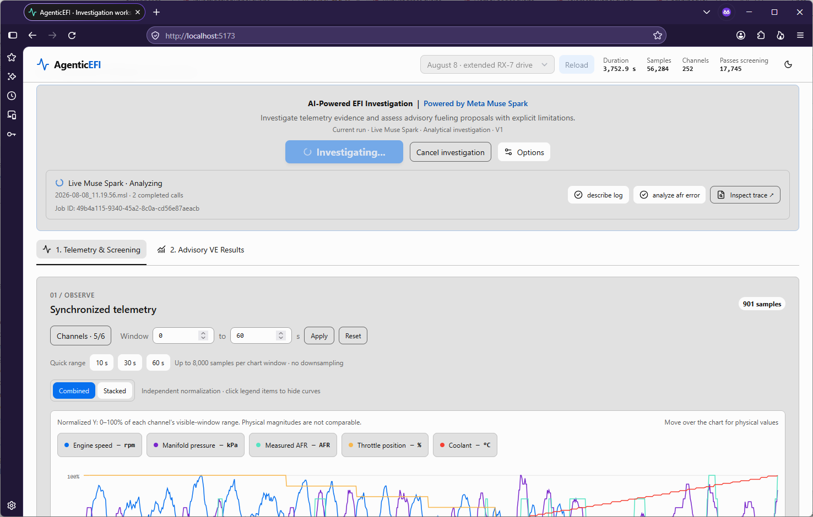
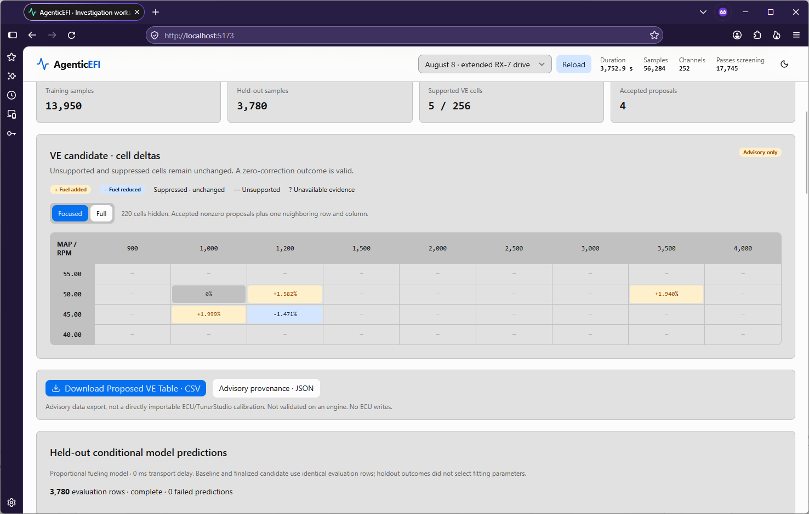

# AgenticEFI

**Evidence-driven engine calibration with Meta Muse Spark**

AgenticEFI is an AI-assisted investigation tool for electronic fuel injection (EFI) datalogs. It transforms noisy engine telemetry into conservative, auditable recommendations for adjusting a volumetric efficiency (VE) fuel table.

**Meta Muse Spark** operates as the investigation agent, invoking deterministic server-side tools to analyze air-fuel ratio (AFR) errors, fit bounded VE correction candidates, evaluate conditional predictions on held-out data, and produce an evidence-backed report.

The application does **not** automatically write to an ECU. Proposed adjustments are advisory and require engineering review and real-world validation.

Built for the **Meta Global AI Developer Hackathon 2026**.

## Demo

**[Watch the 2-minute AgenticEFI demonstration](https://youtu.be/DhirNIFxq4Y)**

The video demonstrates a live Muse Spark investigation using telemetry from a 1994 Mazda RX-7, including tool execution, evidence inspection, VE proposals, held-out evaluation, and CSV export.



*Live Meta Muse Spark investigation with deterministic analytical tool calls.*



*Evidence-supported VE corrections with conditional held-out evaluation.*

## Try it yourself — no API key required

**Requirements:** Node.js 22.17 or newer and npm.

```bash
git clone https://github.com/nesall/agenticefi.git
cd agenticefi
npm ci
npm run dev
```

Open the local URL printed by Vite (normally `http://localhost:5173`).

1. Select the **August 8** dataset.
2. Click **Load selected demo**.
3. Open **Options** and select **Recorded investigation**.
4. Click **Investigate**.
5. Explore the investigation findings, tool evidence, held-out predictions, and advisory VE correction grid.

The August 8 drive log and its calibration tables are bundled with the repository. Asset preparation runs automatically; no separate dataset download, database, or external service is required.

The recorded investigation demonstrates the completed analytical workflow without contacting the Meta API.

**Recorded-mode limitation:** CSV and JSON provenance downloads require a finalized server-owned candidate from a live investigation. Those downloads are disabled for recorded investigations.

## Run a live Meta Muse Spark investigation

Live investigations require a valid Meta API credential with access to the configured Muse Spark model.

Create a local `.env` file in the project root:

```dotenv
META_HACKATHON_API_KEY=your_meta_api_key_here
```

The application also recognizes `META_API_KEY` as a fallback. Process environment variables take precedence over local `.env` values.

Start or restart the development server:

```bash
npm run dev
```

Load a dataset, select **Live Muse Spark** in **Options**, and run the investigation.

**Keep credentials private.** Do not commit `.env` files or API keys. Users supply their own credentials; none are included in this repository.

Live provider access, availability, and charges depend on the user's Meta API account.

## How AgenticEFI works

### 1. Screen noisy telemetry

Real engine logs contain cold-running periods, transient throttle events, possible fuel cut, and insufficiently stable operating conditions. AgenticEFI screens samples before using them to support fuel calibration proposals.

### 2. Investigate with Meta Muse Spark

Muse Spark orchestrates a sequence of deterministic analytical tools:

| Tool | Purpose |
|---|---|
| `describe_log` | Summarize the log and screening evidence |
| `analyze_afr_error` | Identify AFR deviations across operating regions |
| `fit_ve_candidate` | Fit bounded, evidence-supported VE corrections |
| `evaluate_ve_candidate` | Estimate conditional performance on held-out data |

Muse Spark chooses and invokes tools and synthesizes their evidence into a structured advisory report. Numerical computations remain in application-controlled tools rather than being calculated by the language model.

### 3. Propose conservative corrections

The system evaluates whether individual RPM/MAP regions have adequate evidence to support a VE adjustment. Unsupported or rejected regions remain unchanged in the proposed table.

### 4. Evaluate and explain

A held-out evaluation estimates how the candidate would affect AFR prediction error under the analytical model's assumptions.

The results include inspection views linking proposed corrections to sample evidence, server-computed facts, and the tool execution trace.

### 5. Export for engineering review

After a successful live investigation, users can export the complete proposed VE table as CSV and inspect the associated provenance.

No ECU programming or automatic calibration changes occur.

## Example results

The included August 8 demonstration contains **56,284 telemetry samples**.

In the investigation featured in the demo video:

- Five of 256 VE table cells had sufficient support for fitting.
- Four VE correction proposals passed acceptance gates.
- The held-out model predicted reduced AFR error on approximately 3,780 evaluation samples.
- Each proposed adjustment could be inspected alongside the evidence and tool trace.

**These improvements are model-based predictions, not measured post-tuning engine performance.** An exported calibration proposal must be independently reviewed and validated before use.

## Technology

- **Frontend:** SvelteKit, Svelte 5, TypeScript, Tailwind CSS, Skeleton UI
- **Server:** Node.js and deterministic telemetry-analysis tools
- **AI:** Meta Muse Spark through the Meta API
- **Data:** MegaSquirt EFI datalogs and VE / target-AFR calibration tables
- **Testing:** Offline analytical regression tests and UI tests

## Build and deployment

Create and preview a production build:

```bash
npm run build
npm run preview
```

The application uses the SvelteKit Node adapter for deployment behind an appropriately configured reverse proxy.

See [deployment documentation](docs/deployment.md) for packaging and server deployment details.

## Engineering limitations

AgenticEFI is an analytical advisory tool, not an automatic engine tuner.

- Sample screening reduces unreliable evidence but cannot guarantee its correctness.
- VE proposals depend on the supplied calibration, telemetry quality, and analytical assumptions.
- Held-out modeled improvements do not establish real-world safety or performance.
- Users remain responsible for validating any changes before applying them to an engine.

## Project status

Developed for the Meta Global AI Developer Hackathon 2026.

The repository includes a recorded investigation for credential-free evaluation and supports genuine live Muse Spark execution when the user provides a valid API key.